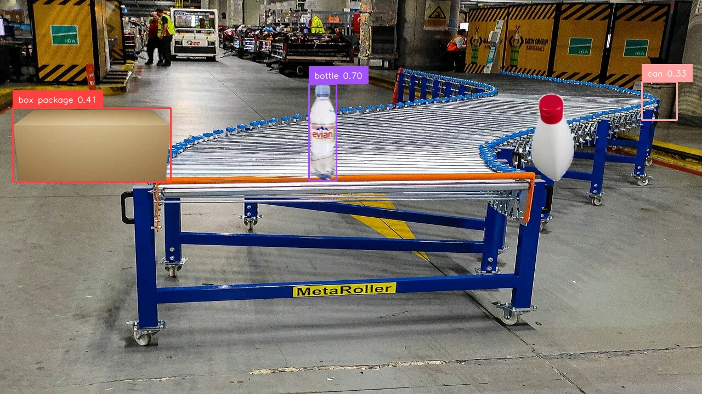

# Project Detector Baseline

How the reproduced pretrained GroundingDINO behaves on conveyor-like imagery — the *deployment*
question, distinct from the paper reproduction.

| | Question | Answer |
|---|---|---|
| Reproduction | Does the official pretrained model reproduce its published COCO AP? | Yes — 48.493 vs 48.5 |
| This document | How does that same model behave on our imagery, at what prompt, threshold and latency? | Below |

**No accuracy figure is claimed here.** There is no labelled project dataset. Everything in this
document is qualitative or a latency measurement.

**No training or fine-tuning was performed.** This is the officially released pretrained
checkpoint, applied unmodified.

Reproduce with: `python scripts/benchmark_detector.py --gdino-root <path> --image <image>`
Data: [`results/project_prompt_study.json`](../results/project_prompt_study.json)

---

## 1. Data used — proxies, not project data

| Image kind | What it is |
|---|---|
| real, public | Real bottles on a real conveyor (public footage), hand-held camera |
| real, public | Real industrial conveyor — machinery, not graspable items |
| semi-synthetic | Real objects composited onto a real belt photograph; **easier than reality** |

The team has recorded **no footage of its own conveyor**. Every observation below is on proxy
imagery and is qualitative.

## 2. Provisional settings

```yaml
prompt:         "box . bottle . can . package ."   # PROVISIONAL
box_threshold:  0.30
text_threshold: 0.25
```

The prompt is **provisional** because the project has not yet selected its conveyor objects.
It is generic warehouse vocabulary standing in for them.

## 3. Prompt study

Six proxy images, thresholds fixed at the baseline:

| Prompt | Detections over 6 images | Behaviour |
|---|---|---|
| `box . bottle . can . package .` | 11 | the provisional combined prompt |
| `box .` | 5 | one per image, **including images containing no box** |
| `bottle .` | 8 | tracks real bottles well |
| `can .` | **0** | never fires on any image |
| `package .` | 10 | fires on **every** image, including the machinery-only frame |

Three observations worth acting on when the real vocabulary is chosen:

1. **`can` is inert on this imagery.** Zero detections across all six images at every threshold
   tested. Carrying it in the prompt costs tokens and buys nothing here.
2. **`package` behaves as a catch-all.** It fires on every image including one containing no
   package — only conveyor machinery. A class that always fires is not discriminating.
3. **Combined prompts can suppress detections that individual prompts find.** On one image the
   combined prompt returned **0** detections while `box .` alone returned 1 and `package .`
   alone returned 2. Open-vocabulary classes compete for the same query slots — so *adding* a
   class can lose detections of another.

These are qualitative observations on proxy data, not statistically validated conclusions.

## 4. Threshold study

Prompt fixed, `box_threshold` swept:

| `box_threshold` | detections | mean confidence |
|---|---|---|
| 0.20 | 23 | 0.334 |
| 0.25 | 16 | 0.381 |
| 0.30 | 11 | 0.433 |
| 0.35 | 6 | 0.517 |
| 0.40 | 5 | 0.543 |

**`text_threshold` had no effect at all** — results at 0.20, 0.25 and 0.30 were identical at
every `box_threshold`. That is expected rather than broken: `text_threshold` filters which
*tokens* are kept when mapping a box back to a phrase, and with single-word class names there is
essentially nothing to cut. It becomes relevant with multi-word class names such as
`"cardboard box"`, which the project may well end up using — so the knob should not be assumed
inert once the real vocabulary exists.

This maps the trade-off; it does not resolve it. Choosing a threshold requires labels to score
against, and there are none.

## 5. Qualitative result

One semi-synthetic frame containing three graspable objects, at the baseline setting:



* `bottle 0.70` — **correct**
* `box package 0.41` — **correct object**, but a **compound grounded phrase** spanning two class
  names
* `can 0.33` — **false positive** on background machinery at the frame edge
* the white shampoo bottle in the foreground — **missed entirely**

So on a frame with three graspable objects: two found, one missed, one spurious detection on
background. That is the honest state of the provisional prompt on proxy data.

**Compound phrases occur.** Grounding DINO grounds a box to a *span of the prompt text*, and
returned `"box package"` — two class names joined — as a single phrase. Any consumer comparing
`phrase == "box"` will mis-handle it. This is a property of open-vocabulary grounding, not a
defect, and it needs handling downstream whatever vocabulary is chosen.

Further examples: [`assets/figures/`](../assets/figures/).

## 6. Runtime

Idle GPU, 5 warm-up iterations discarded, 30 timed, detector forward + post-process only:

| Metric | Value |
|---|---|
| mean | 243.44 ms |
| p50 | 243.88 ms |
| p95 | 253.58 ms |
| p99 | 254.55 ms |
| min / max | 235.05 / 254.69 ms |
| **FPS (mean)** | **4.11** |
| **FPS (p95)** | **3.94** |

Source 1080×1920, resized by the official 800/1333 transform. Variance is tight (mean 243.44 vs
p50 243.88), so this is a stable measurement rather than a noisy one.

### Preliminary visual-servoing implication

```text
30 FPS camera period  =  33.3 ms
GroundingDINO p95     = 253.6 ms
253.6 / 33.3          ≈  7.6
```

**The current GroundingDINO configuration is a detector-side real-time bottleneck for per-frame
30 FPS visual servoing.** It can service roughly one frame in eight.

Two caveats, so the conclusion is not over-read:

* This is a **laptop** RTX 4060, power- and thermally-limited.
* The measurement is detector-only. A deployed loop also pays camera transport, decode, control
  and actuation — all of which make the budget worse, not better.

What this does **not** establish: that GroundingDINO cannot be used for visual servoing. Lower
input resolution, a reduced detection rate, a different backbone and different hardware have not
been evaluated. Those are optimisation questions, deliberately out of scope at the baseline
stage.

## 7. Accuracy

**PROJECT DETECTION ACCURACY NOT YET MEASURABLE.**

No precision, recall, mAP50 or mAP50:95 is reported, because there is no labelled project data
to compute it against. Inventing one from proxy images would be worse than reporting nothing.

The COCO reproduction AP of 48.493 is **not** a project mAP. It measures the published model on
a public benchmark and says nothing about performance on the capstone's conveyor objects.

To make project accuracy measurable, the minimum needed is:

1. **Footage of the actual conveyor** with the actual objects, under the actual lighting and
   camera placement.
2. **A chosen object vocabulary.** Until the grasp targets are fixed there is nothing to label.
3. **Bounding-box annotations in COCO format** for a held-out set. A few hundred frames across
   the intended speed range is enough for a usable precision/recall curve;
   `instances_val2017.json` is the schema to copy.

Only then can thresholds be tuned against ground truth rather than against intuition.
